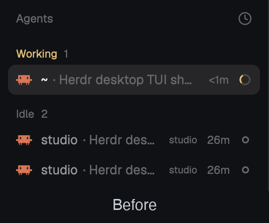

# Herdr Agents list extras

Two drop-in replacements for the Agents list in the [Herdr](https://github.com/herdrdev/herdr-app) app. Each one is a layout and a mod in its own folder. Install one of them, not both: they use the same alt keys.

| Package | What it adds |
|---|---|
| [agent-key-modifier](agent-key-modifier) | `alt+1..9` jumps to agents, like herdr TUI's `focus_agent`, and rows show their number while you hold Option/Alt |
| [agents-grouped](agents-grouped) | everything above, plus a name, group, icon and group color per agent (right-click), drag agents between groups, and a "By group" sort |

## Install

Ask your agent in Herdr, naming the package folder:

> Add the layout at https://github.com/younesehb/agent-key-modifier/tree/main/agents-grouped

Or by hand, from the package's folder: copy `layouts/` and `mods/` into `~/.config/herdr-app/`, merge its `keys.json` into yours, then run `herdr-app do layout.switch --name <package>`.

| Key | Does |
|---|---|
| `alt+1` … `alt+9` | focus that row of the Agents list |
| `alt+0` | show the row numbers for 3 seconds |
| hold Option / Alt | show the row numbers until released (needs a helper below) |
| right-click an agent (agents-grouped) | name, group, icon and group color |
| drag an agent onto a group (agents-grouped) | move it there; onto "No group" to remove it |

### Optional: numbers while Option/Alt is held

A mod can't see modifier keys while a terminal has focus ([#890](https://github.com/herdrdev/herdr-app/issues/890)), so a tiny helper watches the key and tells the mod. No special permissions needed. Pass the package you installed (default `agent-key-modifier`):

- macOS: `sh extras/macos-option-hold/install.sh agents-grouped` (needs Xcode command line tools).
- Windows: `powershell -ExecutionPolicy Bypass -File extras\windows-alt-hold\install.ps1 -Mod agents-grouped` (untested so far; reports welcome).

Switching packages later: run the install again with the other name. Removal steps are at the top of each install script.

## Notes

Groups, names and icons are `hc` labels on each agent's terminal (`alias`, `group`, `icon`, `group_color`), so they survive restarts and work for agents on other machines.

The layouts and mods are clones of Herdr 0.1.15's `main` layout and `agents` mod, so they don't get Herdr's updates. Once [#891](https://github.com/herdrdev/herdr-app/issues/891) (`agent.select {index}`) and [#890](https://github.com/herdrdev/herdr-app/issues/890) land, the keys shrink to a few lines. Each package's `RECIPE.md` says how it's built.

Based on Herdr's shipped `main` layout and `agents` mod, © the Herdr authors, Apache-2.0 ([LICENSE](LICENSE)); changes: agent numbering, keys, groups, names and icons as described in each RECIPE.md.
