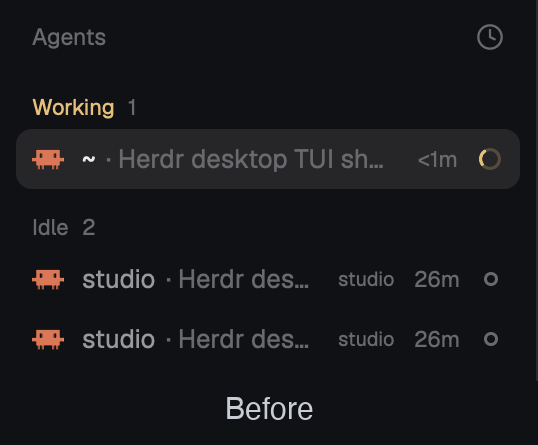

# agent-key-modifier

herdr TUI's `focus_agent = "alt+1..9"` for the Herdr app: `alt+1`…`alt+9` jump to that row of the Agents list, and the first nine rows show their number in a badge while you hold Option/Alt (or for 3 seconds after `alt+0`). Everything else is Herdr's own `main` layout and Agents list, unchanged.

## What you see

Herdr's `main` layout: sidebar on the left (brand, Spaces, Agents, footer), tabs and terminals on the right. The Agents block shows the `agent-key-modifier` mod instead of the shipped `agents` mod; it looks and behaves the same.

While the numbers show, each of the first nine top-level agent rows starts with a 16×16 badge: rounded 4px, `accent` background, `accent_foreground` text, 11px semibold, the row's 1-based position. Rows past nine and sub-agent rows get no badge. The narrow sidebar rail already shows numbers and is unchanged.

## How it behaves

- `alt+1`…`alt+9`: focuses the agent on that row, counting top to bottom as drawn: pinned first, then the list's sort (Priority: Needs you, Done, Working, Idle; or grouped by space). Nested sub-agents without their own row don't count. No row N: nothing happens.
- `alt+0`: badges show for 3 seconds; pressing again restarts the 3 seconds.
- Holding Option (macOS) / Alt (Windows) with Herdr in front: badges show until released. Needs the optional helper in `extras/`.
- Agent statuses, folding, pinning, sorting, clicks and hovers: as the shipped Agents list.

## Built from

- `layouts/agent-key-modifier.json`: a `layout.clone` of `main` (0.1.15) with the `agents` block's `content.mod` set to `agent-key-modifier`.
- `mods/agent-key-modifier/`: a `mod.clone` of the shipped `agents` mod (0.1.15) plus:
  - `this.order = list.map((a) => a.address)` right after its `setAgentOrder(...)` in `render`, so the order is exactly what's drawn;
  - in `init`, a `cx.spawn` loop on `nextCommand()`: `n<N>` → `run("agent.focus", { terminal: this.order[N - 1] })`; `show` → `this.flash = true` and `cx.timer.after(3000, …)` clears it; `hold` / `release` set `this.flash` and cancel the timer;
  - in the full-width row, before the program icon: `.when(this.flash && index < 9, el => el.child(badge))`.
- `keys.json`: `"alt-0": "agent-key-modifier.show"`, `"alt-1": "agent-key-modifier.n1"` … `"alt-9": "agent-key-modifier.n9"` in `global`.
- `extras/macos-option-hold/`: a Swift helper polling `CGEventSource.flagsState` at 30 Hz; Option down (no Cmd/Ctrl) with frontmost bundle `dev.herdr.app` runs `Herdr do agent-key-modifier.hold`, release runs `…release`. `install.sh` builds it and loads a launchd agent `dev.herdr.agent-key-modifier`.
- `extras/windows-alt-hold/`: the same in PowerShell with `GetAsyncKeyState` (Alt down, no Ctrl/Win) and foreground process `herdr-app`, calling `%LOCALAPPDATA%\Programs\herdr-app\herdr-app.exe do …`; `install.ps1` adds a Startup-folder shortcut.

## Watch out

- `<mod>.<command>` keys reach shown copies only, so the mod must be in the shown layout: that's why the layout is cloned too.
- A mod can't see Option/Alt while a terminal has focus (`on_modifiers_changed` is focus-path only), hence the helpers. A modifier-only binding (`"alt": "agent-key-modifier.show"`) works without a helper but fires once, with no release: badges only time out. Don't combine it with the helper.
- Count from the list as drawn (after pinning, sorting and sub-agent nesting), not from `agents()`.
- `mod.clone` rewrites the mod's own name in `openOverlay({ mod: … })` (the sort menu); keep it pointing at this mod.
- Option+digit no longer types characters (`¡`, `™`, `º`) in Herdr on macOS.
- Clones don't get Herdr updates. Upstream asks that make this unnecessary: herdrdev/herdr-app#890 (window-wide modifier event) and #891 (`agent.select {index}`).

## Done when

- `herdr-app check mods/agent-key-modifier` passes and `herdr-app status` shows no errors with the layout shown.
- `herdr-app do agent-key-modifier.n2` focuses the second row (`herdr-app status` → `agent`).
- `herdr-app do agent-key-modifier.show` badges rows 1–9, gone after 3 seconds; `herdr-app shot` shows them.
- With a helper running, holding Option/Alt in Herdr shows the badges and releasing hides them; holding it in another app does nothing.
