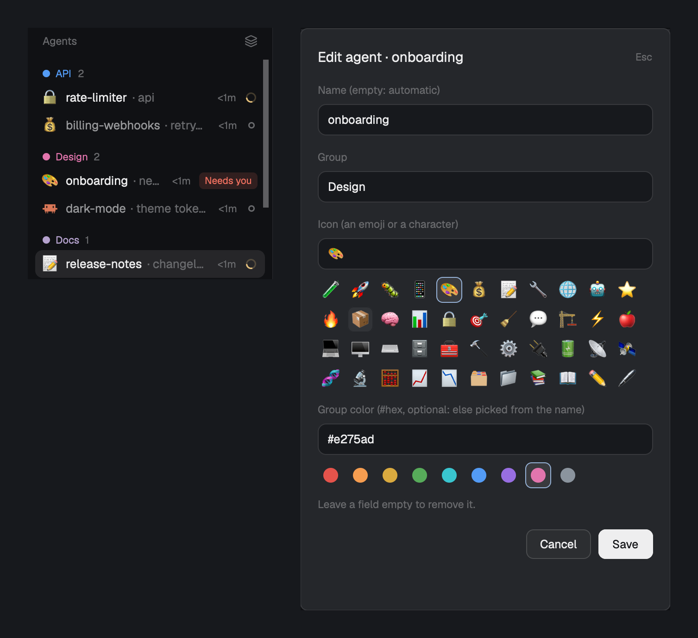

# agents-grouped

Herdr's Agents list with your own groups: give any agent a name, a group, an icon and a group color from a right-click dialog (or `ctrl-a e`), drag agents between groups, sort the list "By group" in an order you drag the headers into, edit a whole group from its header, and let folder rules group new agents by themselves. It also carries [agent-key-modifier](../agent-key-modifier)'s keys: `alt+1`…`alt+9` jump to that row, `alt+0` (or holding Option/Alt with a helper) shows the row numbers.

## What you see

Herdr's `main` layout: sidebar on the left (brand, Spaces, Agents, footer), tabs and terminals on the right. The Agents block shows the `agents-grouped` mod instead of the shipped `agents` mod.

- **Rows** look like the shipped list. An agent with an icon shows it (14px, in the 16px program-icon slot) instead of its program icon. An agent with a name shows that name instead of the automatic one.
- **Grouped agents** in the Priority and "Grouped by space" views get a 2px left border in the group color and the group name at the right of the row (10px, medium, group color, at most 80px, truncated).
- **"By group" view** (third entry of the sort menu, `layers` icon): one header per group, in the order the headers were dragged into (groups never dragged come after, by name), with an 8px round dot in the group color, the group name in that color and the member count; ungrouped agents come last under "No group". Inside a group, most urgent first (Needs you, Done, Working, Idle), then most recently changed. Rows name their space, as in the Priority view. Pinned agents stay in "Pinned" at the top.
- **Group color**: the first member's `group_color` if it's a `#hex`, else one picked from the name (a hash into the theme's `ansi2, ansi4, ansi3, ansi5, ansi6, ansi1, ansi10, ansi12, ansi11, ansi13`), so a group keeps its color with no setup and follows the theme.
- **The agent dialog** (400×690, `popover` background, the body scrolls, the buttons stay at the bottom): title "Edit agent · <name>", then four fields, each a 34px input with a label above: Name (placeholder: the automatic name), Group, Icon, Group color. Under Group, one 24px pill per group in use (8px color dot and name, in the "By group" order). Under Icon, a 96px-tall scrolling grid of 122 emojis in 28px chips; under Group color, nine 16px round swatches (`#e5534b #f69d50 #daaa3f #57ab5a #39c5cf #539bf5 #986ee2 #e275ad #8b949e`). The chosen chip or pill has an `accent` border and `selected` background. Then a 16px checkbox "Also put the other agents in <folder> in this group" (the agent's folder, `~` for the home folder; checked when that folder already has a rule), "Leave a field empty to remove it.", then Cancel and Save (`solid`) buttons.
- **The group dialog** (400 wide, 330px plus 28px per rule): title "Edit group · <name>", a Name input, a Color input with the nine swatches, the folders whose agents join by themselves (each with Remove), then Ungroup all on the left and Cancel and Save on the right.
- **The row numbers** while shown: a 16×16 `accent` badge with the row's number before the icon on the first nine rows.

## How it behaves

- Right-click an agent row, or press `ctrl-a e` with an agent's terminal focused: opens the agent dialog (`ctrl-a e` with no agent focused shows a "No agent to edit" toast). Enter in a field or Save writes the labels and closes it; Esc or Cancel closes without saving. A chip fills its field; clicking the chosen chip again clears it. An empty field removes that label; an empty Name goes back to the automatic name.
- A group pill fills the Group field; clicking the chosen one clears it. The checkbox, saved with a group, makes a folder rule: every agent in that folder or below it, on that machine, whose group nobody chose yet joins the group by itself, now and when it starts later. Saved unchecked or without a group, it removes that folder's rule.
- Right-click a group header in "By group" view: opens the group dialog. Save renames and recolors every member (an empty color goes back to the one picked from the name); Ungroup all removes the group from every member. Folder rules and the header order follow a rename, and go with Ungroup all.
- Drag a group header ("By group" view) onto another one: it moves there, before or after it depending on the direction, and the order is kept. While dragging, the dragged header is at 50% opacity and the target header has a 2px `accent` line on top. "No group" stays last and Pinned first.
- Drag an agent (press, move, release) onto a row that has a group, or in "By group" view onto a group header: it joins that group. In "By group" view, dropping on the "No group" header or on an ungrouped row removes its group. While dragging, the dragged row is at 50% opacity and the target row gets the `hover` background and a 1px border in its group color (`dim` for none); a target header turns `foreground` on `hover`. Leaving the list, or releasing anywhere else, cancels.
- Choosing an agent's group yourself (dialog, drag, group dialog) marks it `group_auto=done`, so a folder rule never moves it again, ungrouped or not; a rule marks the agents it groups `group_auto=rule`.
- Labels are per terminal, so they survive restarts and show on every Herdr window, and they are written where the agent runs (`hc label t5 ...` on `studio` for `studio/t5`). A failed write shows an error toast.
- `alt+1`…`alt+9`, `alt+0` and Option/Alt-hold: as [agent-key-modifier](../agent-key-modifier/RECIPE.md), counting rows as drawn in the current view.
- Statuses, folding, pinning, peeking, clicks and hovers: as the shipped Agents list.

## Built from

- `layouts/agents-grouped.json`: a `layout.clone` of `main` (0.1.15) with the `agents` block's `content.mod` set to `agents-grouped`.
- `mods/agents-grouped/`: a `mod.clone` of the shipped `agents` mod (0.1.15) plus:
  - labels on each terminal (`terminals()[].labels`): `alias`, `group`, `icon`, `group_color`, `group_auto`, written by `writeTags(address, values)`: `hc(["label", t, "k=v", ...])` here, or `exec("hc", ["label", "t5", ...], { on: "studio" })` for `studio/t5`; `k=` removes a label;
  - the dialog is the mod opened again with `openOverlay({ mod: "agents-grouped", kind: "dialog", width: 400, height: 630, props: { edit: address, name, auto, alias, group, icon, group_color } })`; `init` and `render` branch on `props().edit`. Save awaits the `hc` write before `closeOverlay`, since closing cancels the copy's tasks;
  - shared state: `agents.groupOrder` (group names, in the dragged order) and `agents.rules` (`[{ machine, folder, group }]`, machine null for this computer); a rule matches an agent's terminal `cwd` equal to `folder` or below it, the longest folder winning; the list applies rules while rendering, once per agent (`autoTried`);
  - the group dialog is the mod opened again with `props: { groupEdit: name, color }`; Save writes `group`, `group_color` and `group_auto=done` on every live terminal of the group with `Promise.all`;
  - `nextCommand()` `edit` (key `ctrl-a e`) opens the agent dialog for `focused().terminal`, from a map of the rows as drawn;
  - `{ id: "custom", label: "By group", icon: "layers" }` in `SORTS`, saved in `shared("agents.sort")` like the others; the sort popup is 172px tall for the third entry;
  - drag: rows `on_mouse_down("left")` set `this.drag`; rows and "By group" headers `on_mouse_move` set `this.over` and the target group; the list root's `on_mouse_up("left")` does the drop and its `on_hover(false)` cancels;
  - agent-key-modifier's `nextCommand()` loop, `this.order` and badge, under this mod's name.
- `keys.json`: `"alt-0": "agents-grouped.show"`, `"alt-1": "agents-grouped.n1"` … `"alt-9": "agents-grouped.n9"` and `"ctrl-a e": "agents-grouped.edit"` in `global`.
- Optional helper: `../extras/macos-option-hold/install.sh agents-grouped` or `../extras/windows-alt-hold/install.ps1 -Mod agents-grouped`.

## Watch out

- Mouse-move events don't say which button is down, so the drop is decided once, at the list root's mouse-up, from the last target hovered; a drop handled per row would race the root's cancel.
- A remote agent's address is `machine/tN`, but `hc label` on that machine wants the bare `tN`.
- Keep the dialog's `hc` write awaited before closing it, or the write is cancelled with the copy.
- `mod.clone` rewrites `openOverlay({ mod })` names; this mod opens itself for the sort menu and the dialog (`SELF`).
- Agents run by the same terminal share labels: the labels belong to the terminal.
- Without `group_auto`, a rule would put an agent you just ungrouped right back. A rule made after you ungrouped an agent by hand leaves that agent alone too.
- In "By group" only `grp-<name>` headers are drop targets: Pinned and space headers are not groups.
- Header drags and agent drags share the list root's mouse-up; keep them in separate state (`dragG` / `drag`).
- Clones don't get Herdr updates. Don't install both packages' `keys.json`: the alt keys go to one mod.

## Done when

- `herdr-app check mods/agents-grouped` passes and `herdr-app status` shows no errors with the layout shown.
- Right-click → set Group `test` and an icon → Save: `hc get <id>` shows `group=test` and the icon, and the row shows both.
- Sort menu → "By group": a "test" header with its color dot and member count; dragging an agent onto it moves it there, and onto "No group" removes it.
- An empty Name brings back the automatic name; an empty Group removes the agent from the group.
- `ctrl-a e` in an agent's terminal opens its dialog, with a pill for every group in use.
- With the checkbox saved for a folder, a new agent started in that folder joins the group by itself (`hc get` shows `group_auto=rule`); one already in another group stays there.
- Right-click a header → rename it: every member moves to the new name; Ungroup all empties it.
- Dragging a header above another reorders "By group", and the order survives a restart.
- `herdr-app do agents-grouped.n2` focuses the second row; `herdr-app do agents-grouped.show` shows the badges for 3 seconds.
